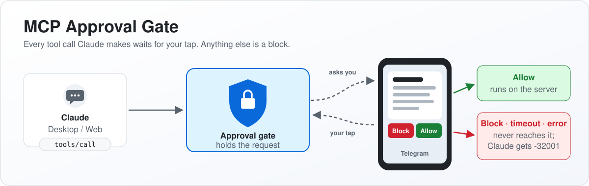
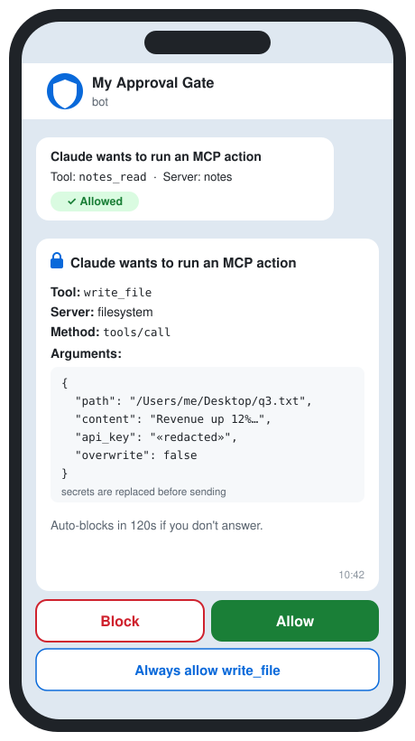
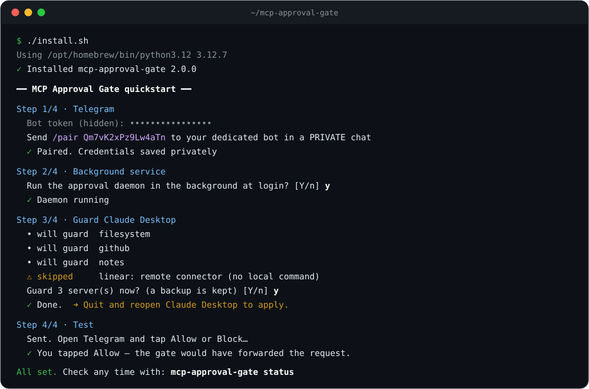
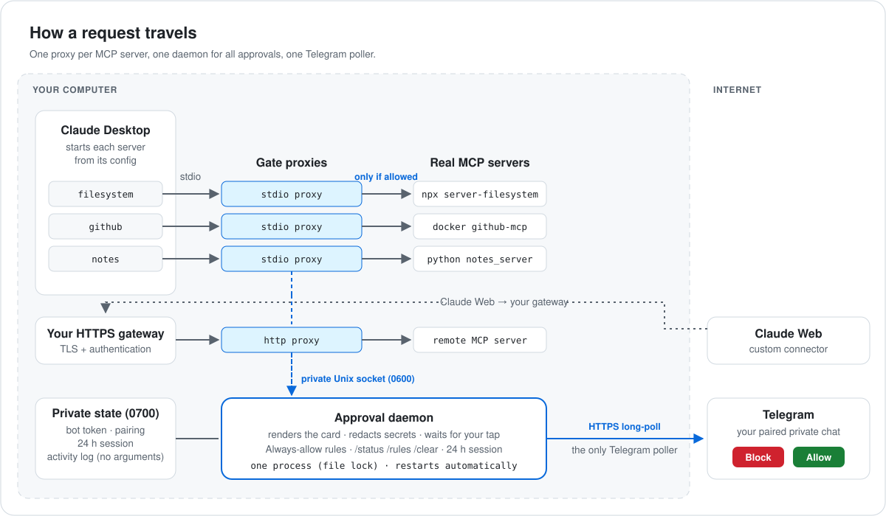
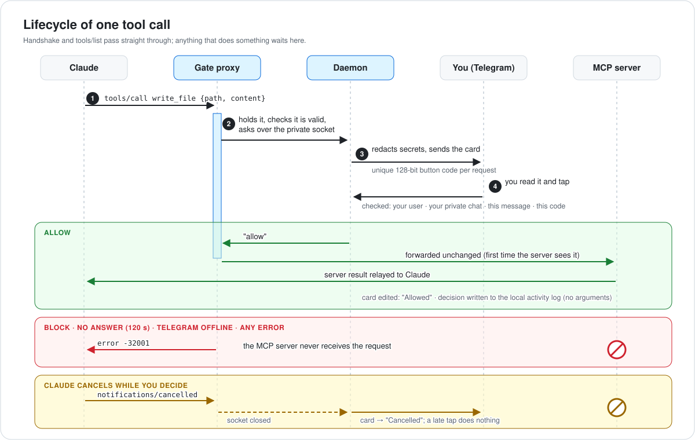
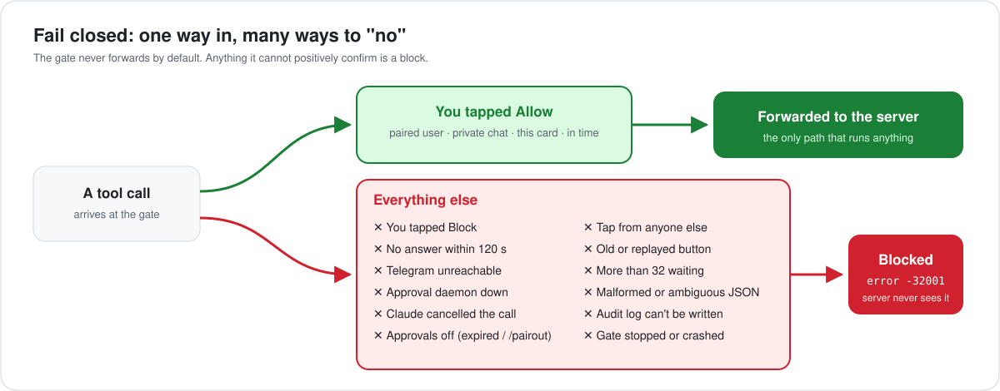

<p align="center">
  
</p>

<p align="center">
  <a href="https://github.com/Adarshagnihotri0/mcp-approval-gate/actions/workflows/ci.yml"></a>
  
  
  
  
  
</p>

**MCP Approval Gate puts a human in front of every tool call Claude makes.** When Claude Desktop (or a Claude Web custom connector) wants to write a file, open a pull request or query a database, the request is held and you get a Telegram message showing exactly what Claude wants to do. Tap **Allow** and it runs. Tap **Block**, ignore it, or lose signal, and the MCP server never sees it.

<table>
<tr>
<td width="56%" valign="top">

### Why

MCP servers give Claude real power over your files, accounts and infrastructure, and once a server is connected, any of its tools can be called. Prompt injection, a misunderstood instruction or a simple mistake can turn into a deleted file or a sent message.

MCP Approval Gate is a **checkpoint you control**:

- 🔒 **Every local server guarded in one command.** `quickstart` wraps everything in Claude Desktop's config, with a backup and one-command undo.
- 📱 **Decide from anywhere.** Approvals arrive on Telegram with the tool, server and arguments.
- 🙈 **Secrets stay home.** API keys, passwords, tokens and credentials in URLs are redacted before anything is sent.
- 🧱 **Fail closed.** No answer, Telegram down, gate stopped, request cancelled: the answer is always *no*.
- ⚡ **Parallel and cancellable.** Many requests wait independently; if Claude gives up, the card is withdrawn and a late tap does nothing.
- 🪶 **Zero runtime dependencies.** Python standard library, `mypy --strict`, 129 tests.

</td>
<td width="44%" valign="top" align="center">

</td>
</tr>
</table>

## Contents

[Quick start](#quick-start) · [How it works](#how-it-works) · [Configuration](#configuration) · [Security](#security) · [Testing](#testing) · [Operations](#operations) · [FAQ](#faq) · [Development](#development) · [Docs](#documentation)

---

## Quick start

**Requirements:** macOS or Linux · Python 3.10+ · Claude Desktop · a Telegram account.

```bash
git clone https://github.com/Adarshagnihotri0/mcp-approval-gate.git
cd mcp-approval-gate
./install.sh
```

That's the whole install. `install.sh` creates a private virtual environment in `~/.local/share/mcp-approval-gate`, links the `mcp-approval-gate` command into `~/.local/bin` (no `sudo`; system Python untouched) and starts the guided **quickstart**:

<p align="center"></p>

| Step | What happens | What you do |
| --- | --- | --- |
| 1 · Telegram | Validates your bot token, pairs **your** private chat with a one-time code | Create a bot with [@BotFather](https://t.me/BotFather) → `/newbot`, paste the token, send the `/pair …` line to your bot |
| 2 · Service | Installs the approval daemon as a login service that restarts itself | Press Enter |
| 3 · Guard | Lists the servers in `claude_desktop_config.json` it will route through the gate, keeps a backup | Press Enter, then **restart Claude Desktop** |
| 4 · Test | Sends a sample approval to your phone | Tap Allow or Block |

Now ask Claude to use any tool, and your phone will ask you first.

<details>
<summary><b>Other install methods</b></summary>

```bash
pipx install mcp-approval-gate                                   # from PyPI (once published)
pipx install git+https://github.com/Adarshagnihotri0/mcp-approval-gate.git  # straight from GitHub
mcp-approval-gate quickstart
```

`install.sh` options: `MCP_GATE_HOME` (install folder), `MCP_GATE_SOURCE` (pip spec to install), `MCP_GATE_PYTHON` (interpreter), `MCP_GATE_NO_QUICKSTART=1` (install only). Whatever installer you use, keep the program where it is: Claude Desktop launches guarded servers with that exact Python.
</details>

---

## How it works

<p align="center"></p>

Claude Desktop starts every local MCP server itself, using the command in `claude_desktop_config.json`, and talks to it in JSON-RPC over stdin/stdout. `wrap-desktop` changes each command so Desktop starts **the gate** instead, and the gate starts the real server behind it:

```diff
  "filesystem": {
-   "command": "npx",
-   "args": ["-y", "@modelcontextprotocol/server-filesystem", "/Users/me/Documents"]
+   "command": "/Users/me/.local/share/mcp-approval-gate/venv/bin/python",
+   "args": ["-m", "mcp_approval_gate", "stdio", "--server", "filesystem",
+            "--approver", "daemon", "--autostart",
+            "--", "npx", "-y", "@modelcontextprotocol/server-filesystem", "/Users/me/Documents"]
  }
```

Claude still sees the same server with the same tools. Every message passes through the gate:

- **Passes straight through:** the handshake and capability listing (`initialize`, `ping`, `tools/list`, `resources/list`, `resources/templates/list`, `prompts/list`), plus notifications and responses. Blocking these would only make Claude think the server is broken.
- **Held for you:** everything that *does* something (`tools/call`, `resources/read`, `prompts/get`, and any method the gate doesn't recognise).

Held requests go to a single background **approval daemon** over a private Unix socket. The daemon is the only process that talks to Telegram, because Telegram allows one poller per bot while Claude Desktop starts every server at once.

<p align="center"></p>

More detail, including threading, the daemon protocol and the failure table, is in **[docs/ARCHITECTURE.md](docs/ARCHITECTURE.md)**. The design reasoning (alternatives considered, trade-offs, cost) is in **[docs/APPROACH.md](docs/APPROACH.md)**.

### What it can and cannot guard

| Claude feature | Guarded? |
| --- | --- |
| Local MCP servers in `claude_desktop_config.json` | ✅ All of them, via `wrap-desktop` |
| Servers you add to the config later | ✅ After re-running `wrap-desktop`; `status` flags anything **UNGUARDED** |
| Your own remote MCP server used as a Claude Web custom connector | ✅ With `http` mode behind your HTTPS gateway ([guide](docs/CLAUDE_WEB.md)) |
| Desktop Extensions installed from Claude's extension directory | ❌ Not stored in `claude_desktop_config.json`; add the server to the config if you need it guarded |
| Anthropic-hosted connectors (Settings → Connectors), web search, file upload, artifacts | ❌ They never pass through your computer, so no local tool can intercept them |

---

## Configuration

Defaults are production-ready; most people never change anything after `quickstart`. Everything below is optional.

### Choosing where you approve

| `--approver` | Where you decide | Arguments shown | Best for |
| --- | --- | --- | --- |
| **`daemon`** *(what `wrap-desktop` uses)* | Telegram, through the shared daemon | Yes, secrets redacted (or hidden with `--hide-inputs`) | Everyday use; any number of servers |
| `popup` | A window on top of all other apps on this computer | Yes, in full; requests too large to show completely are blocked | Working at your desk; nothing leaves the machine |
| `telegram` | Telegram, polled by that one proxy | No (metadata only) | Legacy single-server setups |

Switch every server to the local popup: `mcp-approval-gate unwrap-desktop && mcp-approval-gate wrap-desktop --approver popup`.

### Commands

| Command | What it does |
| --- | --- |
| `quickstart [--yes]` | Guided first run: Telegram → service → guard Claude Desktop → test |
| `status` | Daemon health, approval session time left, guarded/unguarded servers |
| `test` | Sends a sample approval to your phone and reports what you tapped |
| `renew` | Turns approvals back on for 24 h without restarting anything |
| `wrap-desktop` | Routes Claude Desktop servers through the gate (backup kept, safe to re-run) |
| `unwrap-desktop` | Restores the original server entries exactly |
| `install-service` / `uninstall-service` | Background service (launchd on macOS, `systemd --user` on Linux) |
| `activity [--limit N]` | Recent decisions: time, server, tool, outcome; never arguments |
| `uninstall [--purge]` | Unwraps Claude Desktop, removes the service; `--purge` also deletes credentials and history |
| `setup` | Telegram pairing only (part of quickstart) |
| `permissions` | Explains which permissions belong to Claude or macOS rather than the gate |
| `daemon`, `stdio`, `http` | The running components; normally started for you |

`--config PATH` points `quickstart`, `status`, `wrap-desktop`, `unwrap-desktop` and `uninstall` at a non-default Claude config.

### `wrap-desktop` options

| Option | Effect |
| --- | --- |
| `--only github,filesystem` | Guard only these servers |
| `--exclude notes` | Guard everything except these |
| `--approver daemon\|popup\|telegram` | Where approvals happen (default `daemon`) |
| `--strict` | Also ask before handshake and listing calls (Claude will prompt as soon as it connects) |
| `--dry-run` | Print the resulting config without writing it |

### Daemon options

Set them as environment variables for the service, or pass them to `mcp-approval-gate daemon`.

| Option | Env variable | Default | Effect |
| --- | --- | --- | --- |
| `--timeout S` | `MCP_GATE_TIMEOUT` | `120` | Seconds before an unanswered card blocks the request |
| `--hide-inputs` | `MCP_GATE_HIDE_INPUTS=1` | off | Cards show tool and server only, never argument values |
| `--deny-truncated` | `MCP_GATE_DENY_TRUNCATED=1` | off | Block requests whose arguments are too large to show in full, instead of showing a shortened preview |

<details>
<summary><b>How to set daemon options for the background service</b></summary>

**macOS:** edit `~/Library/LaunchAgents/com.mcpapprovalgate.daemon.plist`, add
```xml
<key>EnvironmentVariables</key><dict><key>MCP_GATE_TIMEOUT</key><string>60</string></dict>
```
then reload the agent so launchd reads the new settings:
```bash
launchctl bootout gui/$(id -u) ~/Library/LaunchAgents/com.mcpapprovalgate.daemon.plist
launchctl bootstrap gui/$(id -u) ~/Library/LaunchAgents/com.mcpapprovalgate.daemon.plist
```

**Linux:** `systemctl --user edit mcp-approval-gate` and add
```ini
[Service]
Environment=MCP_GATE_TIMEOUT=60 MCP_GATE_HIDE_INPUTS=1
```
then `systemctl --user restart mcp-approval-gate`.

Note: re-running `install-service` rewrites the macOS plist and drops your additions, so re-apply them afterwards.
</details>

### Telegram commands

Send these to your bot in the paired chat:

| Command | Effect |
| --- | --- |
| `/status` | Gate health, session time left, prompts waiting, rule count |
| `/rules` | Tools you set to *Always allow* |
| `/clear` | Remove every *Always allow* rule |
| `/pairout` | Turn approvals off immediately; everything is blocked until `mcp-approval-gate renew` |
| `/help` | List commands |

**Always allow** applies to one tool on one server, lives in memory only, and is cleared by `/clear`, `/pairout` or a daemon restart. Use it for read-only tools you trust.

### All environment variables

| Variable | Used by | Meaning |
| --- | --- | --- |
| `MCP_GATE_STATE_DIR` | everything | Override the private state folder |
| `MCP_GATE_SOCKET` | daemon, proxies | Override the daemon socket path |
| `MCP_GATE_TIMEOUT`, `MCP_GATE_HIDE_INPUTS`, `MCP_GATE_DENY_TRUNCATED` | daemon | See *Daemon options* |
| `MCP_TELEGRAM_BOT_TOKEN`, `MCP_TELEGRAM_CHAT_ID`, `MCP_TELEGRAM_USER_ID` | daemon | Credentials; normally injected by the launcher from private files, never set by hand |
| `MCP_TELEGRAM_ALERT_CHAT_ID` | daemon | Optional separate group/channel for informational alerts |
| `MCP_APPROVAL_TOKEN` | `http` | Required bearer token for inbound requests |
| `MCP_UPSTREAM_TOKEN` | `http` | Optional bearer token sent to the upstream server |

### Where things live

| What | macOS | Linux |
| --- | --- | --- |
| Program | `~/.local/share/mcp-approval-gate/venv` | same |
| Command | `~/.local/bin/mcp-approval-gate` | same |
| Private state (`0700`): token, pairing, session, socket, activity log | `~/Library/Application Support/MCPApprovalGate/` | `~/.local/state/mcp-approval-gate/` |
| Claude Desktop config (+ `.bak-<time>` backups) | `~/Library/Application Support/Claude/claude_desktop_config.json` | `~/.config/Claude/claude_desktop_config.json` |
| Service definition | `~/Library/LaunchAgents/com.mcpapprovalgate.daemon.plist` | `~/.config/systemd/user/mcp-approval-gate.service` |
| Daemon log | `daemon.log` in the state folder | `journalctl --user -u mcp-approval-gate` |

### Claude Web (remote connectors)

```bash
export MCP_APPROVAL_TOKEN="$(python3 -c 'import secrets; print(secrets.token_urlsafe(48))')"
mcp-approval-gate http --upstream https://your-mcp-server.example.com/mcp --approver daemon --autostart
```

The proxy listens on `127.0.0.1:8765` only. Put an authenticated HTTPS gateway in front of it and point the Claude custom connector at the gateway. Full guide: **[docs/CLAUDE_WEB.md](docs/CLAUDE_WEB.md)**. Every flag is listed in **[docs/CONFIGURATION.md](docs/CONFIGURATION.md)**.

---

## Security

<p align="center"></p>

**The guarantee:** a request that does something reaches an MCP server **only** after the paired person explicitly allows *that exact request*. Every other outcome returns JSON-RPC error `-32001` to Claude, and the server never sees it.

### Who can approve

| Layer | How it's enforced |
| --- | --- |
| **Pairing** | A random one-time code is shown on *your computer* and must be sent from a *private* Telegram chat. That binds one user ID and one chat ID. Groups, channels, other people and bots are ignored. |
| **Every tap** | Must come from that user, in that chat, on the exact card for that request, carrying that request's random 128-bit code. Old, replayed or forged taps do nothing. |
| **Time limit** | Approvals need an active 24 h session. Renewing requires a fresh code shown locally. `/pairout` switches approvals off instantly. |
| **Local access** | The daemon socket is `0600` inside a `0700` folder, so only your OS user can request decisions. Credential files are `0600` and checked for owner, permissions and symlinks before use. |
| **Claude Web** | Inbound bearer token compared in constant time, loopback-only listener, client credentials never forwarded upstream, redirects refused. |

### What is never sent or stored

- **Redacted before sending:** values under credential-like keys (`password`, `token`, `api_key`, `secret_key`, `aws_secret_access_key`, `authorization`, `cookie`, `connection_string`, …), plus known secret formats inside any text: Anthropic/OpenAI keys, GitHub and Slack tokens, AWS access keys, Google API keys, Telegram bot tokens, JWTs, `Bearer …` headers, PEM private keys, `user:password@` in URLs, `?token=` / `?api_key=` query parameters, and `password=…` in connection strings. Ordinary values (paths, text, IDs) stay readable.
- **Never in Claude's config, command lines or logs:** the bot token. A launcher reads it from a private file and passes it through the process environment.
- **Never inherited by MCP servers:** the gate's own credentials are removed from the environment of every server it starts.
- **Never recorded:** arguments and results. The activity log keeps time, server, tool and outcome.

> **Telegram is not end-to-end encrypted.** Telegram can read the cards it delivers. Redaction narrows what it sees, `--hide-inputs` removes arguments entirely, and `--approver popup` keeps everything on your screen.

### Hardening checklist

- [ ] Use a **dedicated** bot for the gate and never share its token (a second program polling it also breaks approvals).
- [ ] Run `mcp-approval-gate status` after adding servers; anything **UNGUARDED** bypasses the gate.
- [ ] Keep *Always allow* for read-only tools; review with `/rules`.
- [ ] Send `/pairout` when you'll be unreachable, so requests fail fast instead of waiting out the timeout.
- [ ] Consider `MCP_GATE_HIDE_INPUTS=1` for servers that handle sensitive data, or `--approver popup` for them.
- [ ] If your phone or Telegram account is compromised: `/pairout`, `mcp-approval-gate uninstall --purge`, then `/revoke` in @BotFather.

**Out of scope:** traffic that never touches your machine; sandboxing the MCP server itself (it runs as you and can read what you can); a compromised user account on your computer; Claude's and macOS's own permission prompts. The full threat model is in **[docs/SECURITY.md](docs/SECURITY.md)**.

---

## Testing

```bash
python -m unittest discover -s tests -v   # 129 tests, ~25 s, no network or accounts needed
mypy                                       # strict type checking
```

Telegram is replaced by an in-memory fake, so taps, edits and outages are deterministic. **MCP servers in the tests are real subprocesses**, so "blocked requests never reach the server" is checked on the filesystem, not with mocks.

| Suite | Tests | What it proves |
| --- | ---: | --- |
| `test_proxy.py` | 43 | Gate rules and strict mode; denied requests never written to the server; ID handling; batches refused; ambiguous JSON rejected; cancellation; server crash; HTTP auth, headers, redirects, SSE, size limits; popup preview limits; audit without arguments |
| `test_telegram.py` | 23 | Pairing, private-chat and user checks, button validation, polling failure, session file security, `/pairout`, alert channel |
| `test_security.py` | 20 | 22 secret formats redacted while ordinary values stay readable; cards always fit Telegram's limit with hostile input; HTML injection; forged and replayed taps rejected; *Always allow* scoped per server; socket permissions and anti-hijack; malformed/oversized/flooding clients; private files and symlinks; credentials not inherited by servers; **fuzzing 3,000 crafted messages with every decision "Block": no action ever forwarded** |
| `test_daemon.py` | 12 | Shared daemon end to end: Allow/Block/timeout, arguments on the card, 6 concurrent requests with mixed answers, cancellation and late taps, session expiry and renewal, real MCP server behind the proxy, Desktop config wrap/unwrap |
| `test_product.py` | 8 | Installed-module wrapping, upgrading 1.x entries, `test`/`uninstall`/`status`/`--version`, service definitions |
| `test_real_use.py` | 8 | stdio and HTTP end to end with the real notes server, parallel requests, failures mid-flight |
| `test_telegram_launcher.py` | 7 | Credentials only from private files; token never on a command line |
| `test_notes_server.py`, `test_html_files.py` | 8 | The example MCP servers: path confinement, symlinks, atomic writes |

**CI** runs everything on macOS and Ubuntu × Python 3.10–3.13, runs `mypy --strict`, builds the wheel, installs it into a clean environment, smoke-tests the CLI and runs `install.sh`. Tagging `vX.Y.Z` publishes to PyPI and GitHub Releases.

A 17-step **manual acceptance checklist** for real Claude Desktop and a real phone (useful before a release or a demo recording) is in **[docs/TESTING.md](docs/TESTING.md)**.

---

## Operations

`mcp-approval-gate status` answers "is it working?":

```text
Daemon:    running, Telegram reachable
Approvals: ON (1312 min left)
Waiting:   0   Always-allow rules: 1

Claude Desktop servers (~/Library/Application Support/Claude/claude_desktop_config.json):
  🔒 filesystem: guarded
  🔒 github: guarded
  ⚠️  linear: remote (not guardable here)
```

### Troubleshooting

| Symptom | Fix |
| --- | --- |
| Claude says a server failed to start | `mcp-approval-gate status`. If the daemon isn't running: `mcp-approval-gate install-service`. Guarded servers refuse to start without a working gate. That's intentional. |
| Every action is blocked and no card arrives | Approvals expired or were switched off: `mcp-approval-gate renew`. |
| No Telegram messages at all | `mcp-approval-gate test`, then check the daemon log (see *Where things live*). Make sure nothing else uses the same bot token. |
| A new server isn't asking | It was added after wrapping: `mcp-approval-gate wrap-desktop`, then restart Claude Desktop. |
| Cards say "Preview shortened" | The arguments are larger than a Telegram message. Use the popup for that server, or `--deny-truncated` to block such requests. |
| `command not found: mcp-approval-gate` | Add `~/.local/bin` to your `PATH` (the installer prints the exact line). |

### Upgrade and uninstall

```bash
cd mcp-approval-gate && git pull && ./install.sh   # upgrade in place; wrapped servers keep working
mcp-approval-gate uninstall           # restore Claude Desktop, remove the service, keep credentials
mcp-approval-gate uninstall --purge   # …and delete token, pairing and history
rm -rf ~/.local/share/mcp-approval-gate ~/.local/bin/mcp-approval-gate   # remove the program
```

---

## FAQ

**Does Claude know the gate is there?**
Only through the result. It sees the same server and tools; a blocked call comes back as an error saying the request was blocked or approval was unavailable.

**What happens if my phone is off?**
After the timeout (120 s by default) the request is blocked. Claude can ask again later.

**Will I get a card every time Claude starts?**
No. Connecting and listing tools pass automatically. Only actions ask (unless you choose `--strict`).

**Can I approve from a group chat or share approvals with a teammate?**
No. Approvals are bound to one person's private chat on purpose. Each person should run their own gate.

**Does it work on Windows?**
Not officially. The shared Telegram daemon, the background service and the installer need macOS or Linux. The local popup mode (`--approver popup`) is plain Python and Tk and may work on Windows, but it is only tested on macOS and Linux.

**Does it cost anything?**
No. It runs on your computer; the Telegram Bot API is free; there are no AI calls or cloud services.

---

## Development

```bash
python -m venv .venv && . .venv/bin/activate
pip install -e ".[dev]"
python -m unittest discover -s tests -v
mypy
python -m mcp_approval_gate.demo     # scripted Allow/Block run with the local popup and the real notes server
```

`assets/demo-illustrated.mp4` is an illustrated recording of that scripted popup demo (not footage of Claude itself).

```text
src/mcp_approval_gate/
  gate.py              decision contract: what passes, what waits, fail-closed rules
  stdio_proxy.py       Claude Desktop transport (wraps a local server)
  http_proxy.py        Claude Web transport (reverse proxy for a remote server)
  approval_daemon.py   the single Telegram owner; cards, rules, session renewal
  daemon_client.py     proxy side of the private socket
  telegram_approver.py Bot API client, buttons, tap validation
  telegram_session.py  24 h approval session
  telegram_launcher.py loads credentials from private files
  request_format.py    approval card rendering and secret redaction
  popup.py             topmost local window approver
  desktop_config.py    wrap / unwrap / status for claude_desktop_config.json
  service.py           launchd / systemd service
  cli_admin.py         quickstart, setup, test, renew, status, uninstall
  main.py              command-line entry point
  activity.py, paths.py, examples/
tests/                 129 tests (see Testing)
docs/                  architecture, approach, security, testing, configuration, Claude Web
assets/                diagrams used in this README
```

Contributions: see [CONTRIBUTING.md](CONTRIBUTING.md). The rules are short: fail closed, no runtime dependencies, `mypy --strict` passes, and new behaviour gets a test against the real example server.

## Documentation

| Document | Read it for |
| --- | --- |
| [docs/ARCHITECTURE.md](docs/ARCHITECTURE.md) | Components, request lifecycle, concurrency, daemon protocol, failure handling |
| [docs/APPROACH.md](docs/APPROACH.md) | How the problem was analysed, alternatives rejected, challenges, trade-offs, cost |
| [docs/SECURITY.md](docs/SECURITY.md) | Threat model, authentication layers, out-of-scope, reporting vulnerabilities |
| [docs/TESTING.md](docs/TESTING.md) | Test map and the manual acceptance checklist |
| [docs/CONFIGURATION.md](docs/CONFIGURATION.md) | Every command, flag, variable and file |
| [docs/CLAUDE_WEB.md](docs/CLAUDE_WEB.md) | Guarding a Claude Web custom connector |
| [CHANGELOG.md](CHANGELOG.md) | Release history |

Licensed under the [MIT License](LICENSE).
